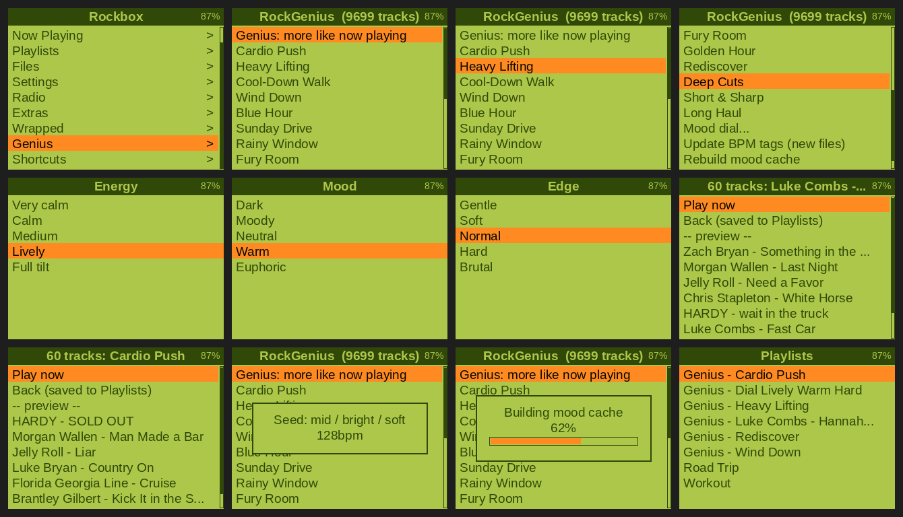

# RockGenius

RockGenius makes "Genius"-style playlists on a Rockbox player, on the player itself. Start a song, open it, and it builds a playlist of songs with a similar feel. It also has preset lists for moods and workouts, and a dial for picking energy, mood and edge yourself. It's a single Lua file. It works out how a song feels from your tags (genre, title words, length, and BPM if you have it), so there's no cloud and no audio analysis on the player.



*Screens from version 2 on my iPod Video. Version 3 groups the menu into Genius, Moods, Workouts, Discovery, Mood dial and Tools, and the "Genius" entry in the Rockbox main menu is from my own build. On stock Rockbox you open it from Plugins or Shortcuts.*

## Features

- Genius from the song that's playing:
  - More like this
  - Same vibe, other artists
  - Same vibe, same genre
  - Take it up a notch
  - Bring it down
  - Era match
  - Deep cuts like this
- Preset lists:
  - Moods: Golden Hour, Sunday Morning, Road Trip, Late Night Drive, Focus, Breakup, Wind Down, and more.
  - Workouts: Cardio Push, Heavy Lifting, Pregame, and Running at 160, 170 or 180 steps per minute, matched on BPM.
  - Discovery: Rediscover, Deep Cuts, Throwback, Long Haul.
- A mood dial: seven steps each for energy, mood and edge, plus era and length.
- Playlists of 25, 50 or 100 songs, saved to `/Playlists`. Play now starts one straight away on stock Rockbox.
- No more than three songs per artist, and no artist twice in a row.
- Stays inside the plugin's 512 KB of memory on big libraries, so the music keeps playing.
- Optional desktop tools for macOS, Windows and Linux:
  - `bpm_tag.py` detects BPM and writes it into your files.
  - `bpm_export.py` hands BPM and mood scores to the player, so it never has to scan.
  - `fix_names.py` tidies long file names.

## Install

Copy `rockgenius.lua` to `/.rockbox/rocks/apps/` on the player. Build the database (Settings > General Settings > Database > Initialize Now). Then open Plugins > Applications > rockgenius.lua.

The [guide](docs/GUIDE.md) covers the whole setup:

- tagging your music;
- shortcuts for one-press access;
- BPM;
- what every menu does;
- troubleshooting, limitations, and how to add your own genres, words and presets.

## Tests

The `test/` folder runs the plugin off-device against synthetic Rockbox databases. It uses two Lua interpreters: Lua 5.1 through [lupa](https://github.com/scoder/lupa), and a Lua 5.1.5 built with Rockbox's integer settings. GitHub Actions runs it on every push.

```sh
pip install -r test/requirements.txt
python -m pytest test/
```

## Licence

MIT. Use it, change it, share it, sell it. Just keep the copyright notice and the [LICENSE](LICENSE) text with it. The one exception is `test/intlua/rockbox_luaconf.h`, which is adapted from Rockbox and stays GPL-2.0-or-later.
